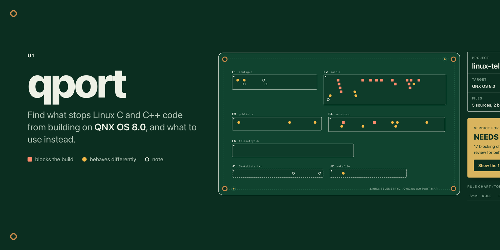
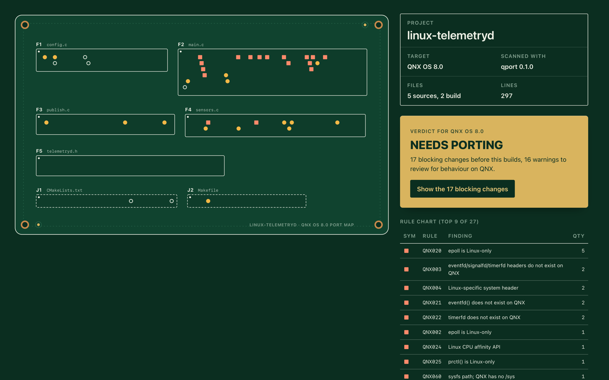
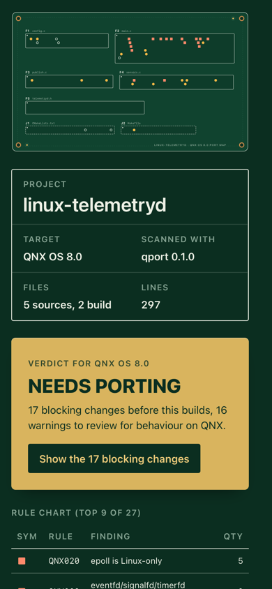

<p align="center"></p>

# qport

**Find what stops Linux C and C++ code from building, or behaving the same, on QNX OS 8.0, and what to use instead.**

Porting a Linux component to QNX usually starts with a compile that fails on `sys/epoll.h`, then a link that fails on sockets, then a crash from a stack buffer that was fine on Linux. qport finds those problems up front. It scans a source tree and reports every Linux-only header, call, flag, path and build setting, with the QNX 8.0 replacement and the QNX documentation page each rule comes from.

- **Rules grounded in the QNX 8.0 docs.** 49 rules, each citing the QNX Porting Guide or the QNX OS 8.0 C Library Reference (`qport rules`, `qport explain QNX022`).
- **Reads your `#if`s.** Code inside `#ifdef __linux__`, `#ifndef __QNX__`, `#if __GLIBC__ >= 2` or `#if 0` is set aside, because a QNX build never compiles it.
- **Sizes stack arrays.** Resolves project `#define`s and struct layouts, so `struct sample batch[100 * MAX_SIGNALS * 4]` is reported as 400 KiB. qcc's default stack is much smaller than Linux's 8 MB.
- **Checks the build, not just the code.** Missing `-lsocket`, `-lregex`, `-lfsnotify`; `-fsplit-stack`; Makefiles that pick the platform with `uname` (the build host, not the QNX target); Linux-only CMake branches.
- **Checks headers against the real SDP.** With `$QNX_TARGET` set, every `#include <...>` is looked up in the QNX 8.0 target sysroot; anything missing is a library you still have to port.
- **Writes the QNX build config.** `qport toolchain` emits a QNX 8.0 CMake toolchain file and make settings for `aarch64le` or `x86_64`, with the libraries the scan found already on the link line.
- **Fits into CI and review.** Text, one-line `--brief`, JSON, SARIF 2.1.0 (GitHub code scanning), Markdown, and a single-file HTML port map. Exit status 1 on errors (`--fail-on`).
- **Portable C11, no dependencies.** Plain C11 + POSIX with a host build (`make`, CMake) and a QNX OS 8.0 build (`make qnx` with `qcc`). It builds for QNX 8.0 `x86_64` and `aarch64le` and runs on a QNX 8.0 target.

## Quick start

```sh
make                      # builds ./qport with cc
make test                 # unit tests + 45 fixture tests
./qport scan examples/linux-telemetryd
```

```text
src/main.c
  51:14   error   QNX022  timerfd_create: timerfd does not exist on QNX
                          | int fd = timerfd_create(CLOCK_MONOTONIC, TFD_NONBLOCK);
                          fix: Use timer_create() with a SIGEV_PULSE sigevent and receive the pulse
                               with MsgReceivePulse(): deterministic periodic timers are what QNX is
                               built for. Use CLOCK_MONOTONIC.
  ...
Summary: 17 errors, 16 warnings, 6 notes  (1 more inside #if branches QNX does not compile; --show-guarded)
Top rules: QNX020 x5, QNX003 x2, QNX004 x2, QNX021 x2, QNX022 x2, QNX032 x2
Link on QNX: -lsocket -lregex -lfsnotify
Verdict: needs porting: 17 blocking changes before this builds for QNX 8.0.
```

The full output is in [`assets/scan-output.txt`](assets/scan-output.txt). `examples/linux-telemetryd` is a small Linux daemon written the way a lot of embedded Linux code is (epoll, timerfd, eventfd, CPU pinning, sysfs, System V shared memory, inotify, regex, UDP). It targets Linux only and is input for the demo and tests.

## The port map

```sh
./qport scan -f html -o report.html examples/linux-telemetryd
```

One self-contained HTML file, no network access. Each source file is a footprint on a board, sized by line count; each finding is a pad placed at its line: square for errors, round for warnings, hollow for notes. The title block and verdict say how far the code is from building on QNX; the rule chart shows where the work sits. Click a pad or a rule to jump to the finding, and open any finding for the source line, the QNX fix and the documentation it comes from.

<p> </p>

## Commands

```text
qport scan [options] <path>        scan a source tree or one file
qport toolchain [options] <path>   scan, then write QNX 8.0 CMake/make config
qport rules                        list the rules
qport explain <RULE>               show one rule and its source

  -f, --format text|brief|json|sarif|md|html
  -o, --output FILE
      --sysroot DIR                QNX target dir for the header check (default: $QNX_TARGET)
      --no-sysroot
      --stack-threshold BYTES      default 65536
      --show-guarded               include code inside #if branches QNX skips
      --exclude NAME               skip directories with this name
      --fail-on error|warning|note|never
      --arch aarch64le|x86_64      (toolchain)
      --out DIR                    (toolchain)
```

Silence a line with `// qport:ignore` or `// qport:ignore QNX020 QNX021`; skip a file with `qport:ignore-file`.

In CI, `qport scan -f sarif -o qport.sarif .` produces a SARIF 2.1.0 file that GitHub code scanning can show inline on pull requests.

## Building and running qport on QNX OS 8.0

qport is plain C11 plus POSIX. It is built with the QNX SDP 8.0 toolchain and runs on a QNX OS 8.0 target.

| | |
|---|---|
| QNX version | QNX OS 8.0 (QNX Software Development Platform 8.0, QNX Everywhere licence) |
| Toolchain | `qcc` 12.2.0 from SDP 8.0: `-Vgcc_ntox86_64` and `-Vgcc_ntoaarch64le` |
| Target that ran it | QNX OS 8.0 `x86_64` image made with `mkqnximage --type=qemu`, booted in QEMU 8.2 with KVM |
| Also built for | `aarch64le` (built with no warnings; not run on hardware) |

```sh
source ~/qnx800/qnxsdp-env.sh          # sets QNX_HOST and QNX_TARGET
make qnx QNX_ARCH=x86_64               # -> build-qnx-x86_64/qport and unit
make qnx QNX_ARCH=aarch64le            # -> build-qnx-aarch64le/qport and unit
make qnx-test                          # host qport, checking headers against $QNX_TARGET
```

Then copy `build-qnx-x86_64/qport`, `unit` and `examples/` to the target and run `./unit` and `./qport scan examples/linux-telemetryd` there. The full walkthrough, including the QEMU image and the ssh port forward, is in [`docs/QNX.md`](docs/QNX.md).

## Evidence of QNX use

Everything below was run on 2026-11-26 on a Linux x86_64 host (Ubuntu 24.04) with QNX SDP 8.0 installed. The logs are the unedited output; each command is printed before its output.

**Built with the QNX 8.0 toolchain.** `make qnx` (see `Makefile`) runs `qcc -Vgcc_nto<arch> -D_QNX_SOURCE` on all of `src/` and on `tests/unit.c`. Both targets build with no warnings and produce QNX ELF binaries (`interpreter /usr/lib/ldqnx-64.so.2`):
[`assets/qnx-build-x86_64.log`](assets/qnx-build-x86_64.log), [`assets/qnx-build-aarch64le.log`](assets/qnx-build-aarch64le.log).

**Runs on QNX OS 8.0.** The x86_64 build was copied to a QNX OS 8.0 virtual machine and run there ([`assets/qnx-target-run.log`](assets/qnx-target-run.log)):

```text
$ uname -a
QNX qnx8 8.0.0 2026/10/30-09:10:05EDT x86pc x86_64
$ ./unit
unit: all checks passed
$ ./qport scan examples/linux-telemetryd
...
Summary: 17 errors, 16 warnings, 6 notes  (1 more inside #if branches QNX does not compile; --show-guarded)
Verdict: needs porting: 17 blocking changes before this builds for QNX 8.0.
$ ./qport scan src
qport 0.1.0  QNX OS 8.0 portability scan of src
9 source files, 0 build files, 4906 lines

Summary: 0 errors, 0 warnings, 0 notes
Verdict: no blockers found for QNX 8.0.
```

The HTML port map written on the QNX target ([`assets/report-from-qnx.html`](assets/report-from-qnx.html)) is byte-for-byte the same file the macOS build writes.

**Checked against the real QNX 8.0 sysroot.** With `$QNX_TARGET` set, `header_in_sysroot()` in `src/scan.c` looks up every `#include <...>` in `$QNX_TARGET/usr/include` (and `usr/include/c++/<ver>`); anything missing there and not in the project is rule `QNX090`. `make qnx-test` runs this on qport's own source (clean) and the example: [`assets/qnx-header-check.log`](assets/qnx-header-check.log). As a cross-check of the rule set, the 8 headers the example uses that are missing from the SDP 8.0 sysroot (`sys/epoll.h`, `sys/eventfd.h`, `sys/timerfd.h`, `sys/prctl.h`, `sys/sysinfo.h`, `sys/shm.h`, `execinfo.h`, `linux/watchdog.h`) are each reported by a qport rule, and `sys/inotify.h`, which is present, is reported only as a note about `libfsnotify`: [`assets/qnx-sysroot-crosscheck.log`](assets/qnx-sysroot-crosscheck.log).

**QNX knowledge in the code.**

- `src/rules.c`: the 49 rules, each with the QNX 8.0 replacement (for example `timer_create()` with `SIGEV_PULSE` and `MsgReceivePulse()` for timerfd, `ThreadCtl(_NTO_TCTL_RUNMASK_GET_AND_SET_INHERIT, ...)` for CPU affinity, `procmgr_ability()` for prctl capabilities, `-lsocket` / `-lregex` / `-lfsnotify` for the QNX link line) and the QNX documentation page it comes from.
- `src/scan.c`: `eval_on_qnx()` evaluates `#if` / `#ifdef` conditions the way a QNX 8.0 build sees them (`__QNX__`, `__QNXNTO__` defined; `__linux__`, `__GLIBC__` not), `check_local_array()` sizes stack arrays against qcc's small default stack, `link_checks()` compares socket, regex and inotify use with the libraries the build links.
- `src/emit.c`: `emit_toolchain()` writes a QNX 8.0 CMake toolchain file and make fragment (`qcc -Vgcc_nto<arch>`, `CMAKE_SYSTEM_NAME QNX`, `CMAKE_SYSROOT $QNX_TARGET`) with the libraries the scan found.

## How it works

1. **Tokenize.** A forgiving C/C++ tokenizer separates identifiers, literals and preprocessor directives, so rules never fire inside comments or strings (`src/lexer.c`).
2. **Evaluate `#if` branches as QNX would.** A small three-valued evaluator knows which macros QNX 8.0 defines (`__QNX__`, `__QNXNTO__`, `__unix__`) and which it does not (`__linux__`, `__GLIBC__`, `__APPLE__`, ...). Unknown conditions count as compiled, so nothing is hidden by a guess (`src/scan.c`).
3. **Learn the project.** A pre-pass records integer `#define`s and simple struct layouts, used to size local arrays.
4. **Apply the rules.** Calls are matched as real calls (not member calls, qualified names, or declarations of your own shims); includes, macros, string paths and build-file text have their own rule kinds (`src/rules.c`).
5. **Cross-check the build.** Socket, regex and inotify use is compared with what the build files link.
6. **Report.** Text, JSON, SARIF, Markdown or the HTML port map (`src/report.c`, `report/template.html`).

## Verified

- QNX OS 8.0: built with `qcc` for `x86_64` and `aarch64le` with no warnings; on a QNX OS 8.0 x86_64 QEMU target, `./unit` passes, the example scan and HTML report run, and qport's own source scans clean (see [Evidence of QNX use](#evidence-of-qnx-use)).
- Host: builds with Apple clang and with gcc 13 (C11, `-Wall -Wextra -Wpedantic`, no warnings) via `make`; compiles cleanly with only `_POSIX_C_SOURCE=200809L` defined. Log: [`assets/host-build-gcc.log`](assets/host-build-gcc.log).
- `make test`: tokenizer unit tests and 45 fixture tests (branch analysis, false positives, stack sizing, sysroot header oracle with a stand-in sysroot, suppressions, link checks, JSON/SARIF/Markdown/HTML output, toolchain generation, self-scan).

**Not verified:** running the `aarch64le` build on ARM hardware, and the CMake build with the generated `cmake/qnx-*.cmake` toolchain files (the QNX build above used `make qnx`).

## Limits

- Heuristic, not a compiler: no full macro expansion, so code produced by macros is not analysed, and conditions on project macros count as compiled.
- The rule set covers common Linux-to-QNX problems from the QNX Porting Guide and the C Library Reference; it is not exhaustive. "Not in the QNX 8.0 C Library Reference" means no entry there; check your SDP when in doubt.
- Stack sizing understands basic types, pointers and simple structs; unions, bit-fields and templates are skipped.

## Licence

MIT. See [LICENSE](LICENSE).
